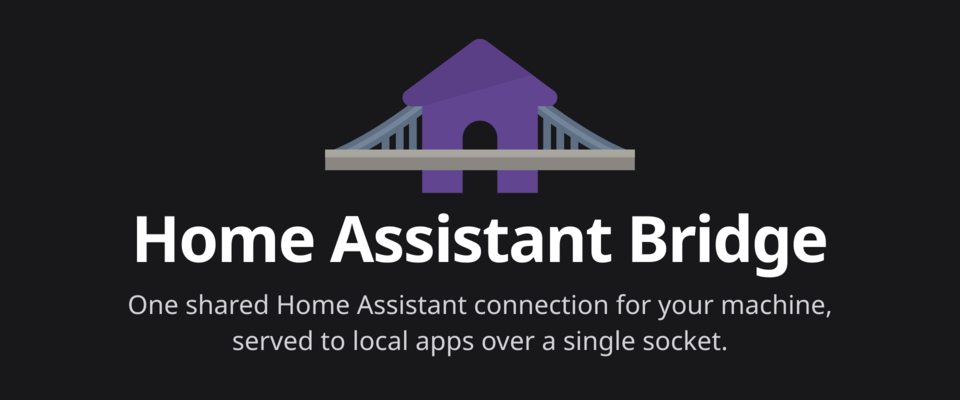

# Home Assistant Bridge



One shared Home Assistant connection for your machine, served to local apps over a single socket.

See the [documentation](https://ha-bridge.timmo.dev) to install, configure and use it.

## Agent skills

The `ha-bridge-cli` skill teaches coding agents to use the CLI, and the `home-assistant` skill teaches them to look up how Home Assistant works and write automations the current way. Install them with the [Skills CLI](https://skills.sh):

```bash
npx skills add timmo001/ha-bridge --skill ha-bridge-cli --skill home-assistant
```

Or in Claude Code:

```text
/plugin install ha-bridge --marketplace timmo001/ha-bridge
```
