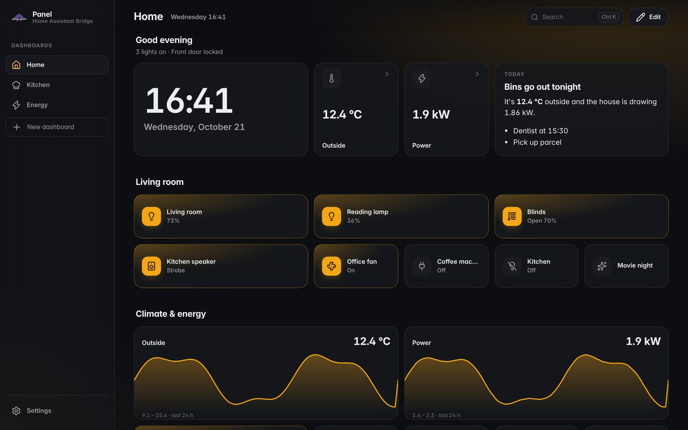
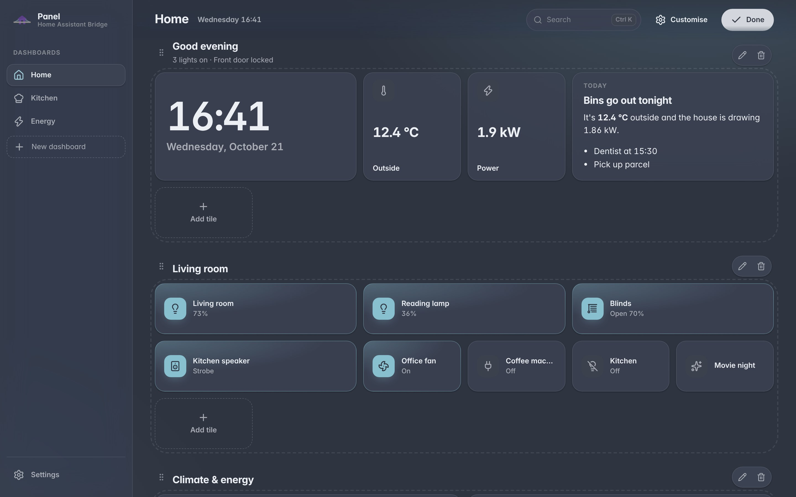
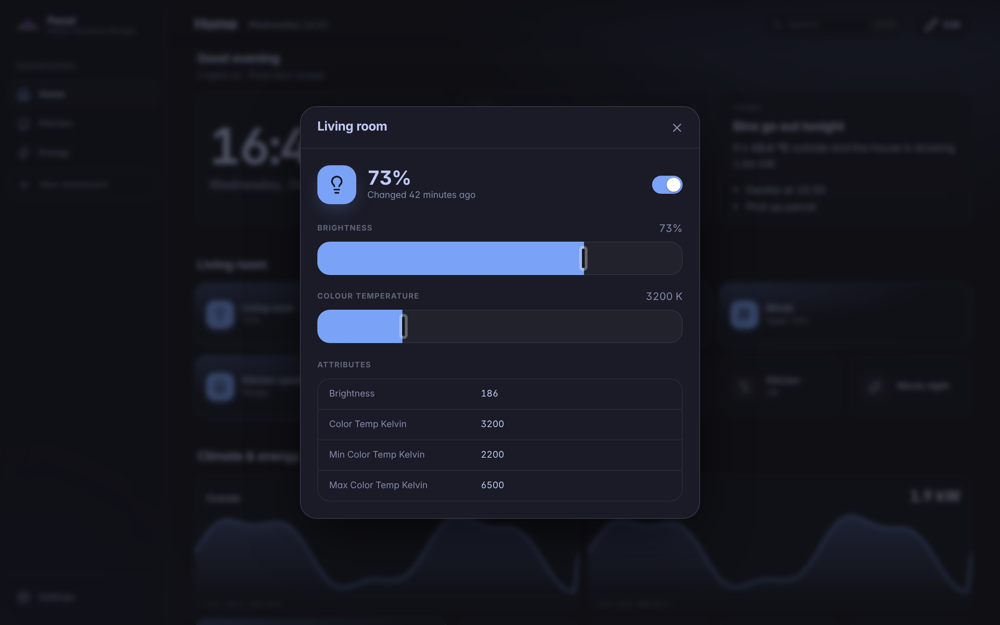
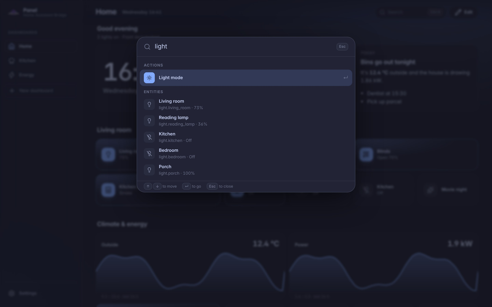
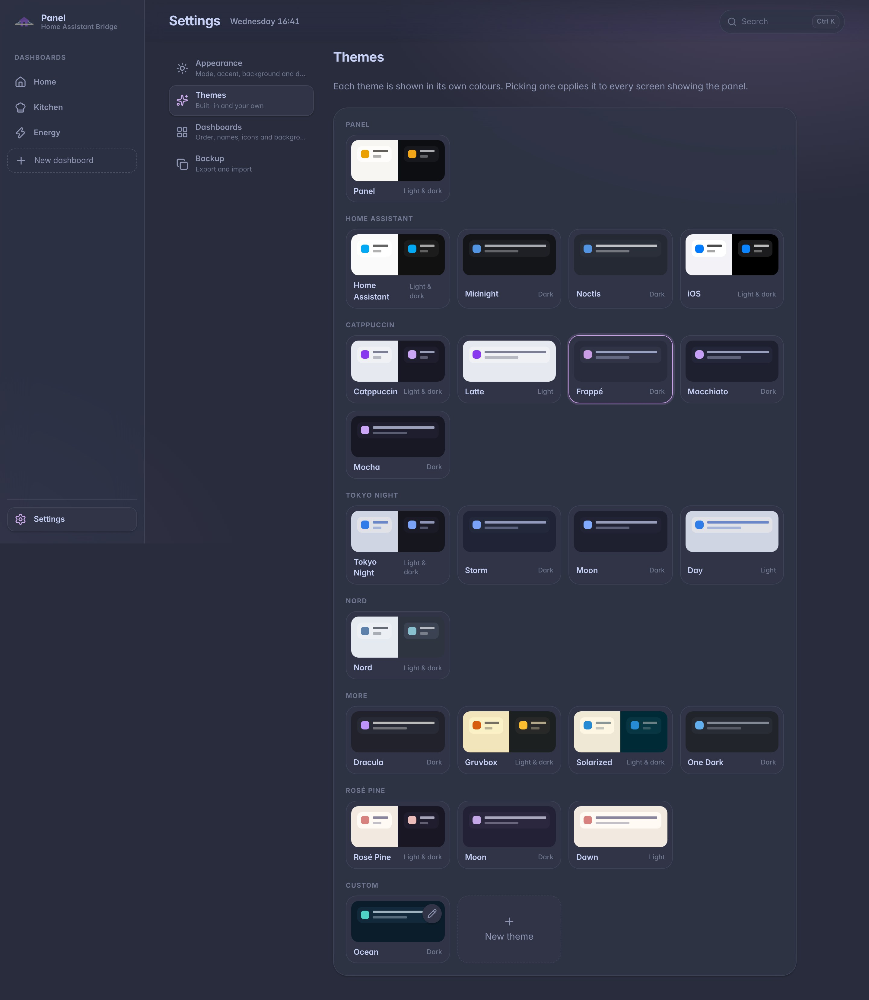

`ha-bridge panel` serves a dashboard in the browser. It's for a wall tablet, a spare screen or a browser tab: dashboards made of sections, each a grid of tiles for entities, history, notes, clocks, checklists, images and other pages.

The panel is another bridge client. It reaches Home Assistant through the bridge socket, so `ha-bridge serve` must be running, and it never opens its own Home Assistant connection.

```bash
ha-bridge panel
```

Then open `http://127.0.0.1:7291`.



## Options

| Flag | Default | What it does |
| --- | --- | --- |
| `--host` | `127.0.0.1` | Address to listen on |
| `--port` | `7291` | Port to listen on |
| `--data` | `$XDG_CONFIG_HOME/ha-bridge/panel.json` | File the dashboards and settings are saved to |

To use the panel from a tablet, listen on your network with `--host 0.0.0.0`. Anyone who can reach that address can see your dashboards and control Home Assistant through them, so only do this on a network you trust, or put the panel behind a reverse proxy that signs people in.

The panel only accepts its socket from pages it served itself, so a website open in your browser can't use it to reach Home Assistant.

## Dashboards

Each dashboard is a list of sections, and each section is a grid of tiles. Choose **Edit** to change one:

- **Add tile** opens a menu of tile types beside it. Pick one, fill in its editor and watch the preview change.
- Drag a tile to move it, within a section or to another one.
- Drag a section by its header to move it above or below another.
- The pencil on a tile edits it; the bin removes it.
- A section's pencil renames it and sets how many columns it has; its bin deletes it.
- **Add section** adds a section at the end.
- **Customise** opens the dashboard's settings page: its name, icon and own background, or deleting it.

Editors open in the middle of the screen and stay open if you click outside them, so a stray tap doesn't lose your changes; press Escape, **Cancel** or the close button to leave. An entity's details close on a click outside.



A tile's width and height are in grid cells. A section has up to six columns and shows fewer on narrow screens; a tile never spans more columns than are shown.

Dashboards with many sections stay quick, as only the sections near the screen are drawn.

## Tiles

| Tile | Shows |
| --- | --- |
| Entity | An entity's icon, name and state, lit in the accent colour while it's on. Tapping toggles it, opens its details or does nothing; a long press or right click always opens its details. |
| History | A numeric sensor's values over the last 6 hours to a week, as a line. |
| Note | Markdown, rendered by Home Assistant as a [template](/using/templates) first, so `{{ states('sensor.outside_temperature') }}` shows the current value. |
| Clock | The time, with the date and seconds if you like. |
| Checklist | A list to tick off, shared by every screen showing the panel. |
| Image | A picture from a URL, filling or fitting the tile. |
| Web page | Another page, embedded. Some sites refuse to be embedded. |

An entity's details show controls for its domain: brightness and colour temperature for lights, position for covers, target temperature and mode for climate, playback and volume for media players, speed for fans, values and options for numbers and selects. Numeric entities also show their last day of history.



The entity picker lists every entity, sorted by name, domain or state, and filters as you type or by domain.

## Finding anything

Press ⌘K, or Ctrl+K, or choose **Search** in the top bar, to search everything in the panel: dashboards, settings pages, actions such as editing the dashboard or switching to dark mode, every theme, and every entity. Type to filter, move with the arrow keys and press Enter to go. Choosing an entity opens its details.



## Settings

Settings apply to every screen showing the panel, and change as soon as you pick them. Each area has its own page, at `/settings/<page>`:

- **Appearance** (`/settings/appearance`): mode, accent, density, background, the 24-hour clock and kiosk mode.
- **Themes** (`/settings/themes`): every theme, and a page for each of your own, at `/settings/themes/<id>`.
- **Dashboards** (`/settings/dashboards`): drag to reorder, and a page for each dashboard, at `/settings/dashboards/<id>`.
- **Backup** (`/settings/backup`): export and import.

What you can set:

- **Theme**: Panel, Home Assistant, Midnight, Noctis, iOS, Catppuccin (Latte, Frappé, Macchiato and Mocha), Tokyo Night (Night, Storm, Moon and Day), Nord, Dracula, Gruvbox, Rosé Pine (Main, Moon and Dawn), Solarized and One Dark, each shown in its own colours. **New theme** makes your own from a background, card, text and accent colour.
- **Mode**: for themes with light and dark versions, follow the device or always use one.
- **Accent**: the theme's own, or one of seven colours laid over any theme.
- **Background**: the theme's glow, its plain background, a colour, or an image with blur and dim, so tiles stay readable. A dashboard can set its own on its settings page.
- **Density**: comfortable or compact tiles.
- **24-hour clock**.
- **Kiosk mode** hides navigation and editing. Open `/settings` to turn it off again.



**Export** downloads every dashboard and setting as one JSON file, and **Import** restores one. Imported dashboards replace those with the same ID.

## Trying it without Home Assistant

From a checkout, `mise run panel:demo` runs the panel against a demo bridge with made-up lights, sensors, a lock, a speaker and more, on `http://127.0.0.1:7320`. Actions change the demo's entities, so tiles respond, and changes to dashboards are kept between runs. `mise run panel:demo --reset` starts again from the demo dashboards, and `mise run serve:panel:demo` runs it in the background through Pitchfork.

With the demo running, `mise run panel:screenshots` captures the screenshots on this page into `docs/src/assets/panel`. It needs Playwright's Chromium, from `bunx playwright install chromium`.

## Running it as a service

The panel runs like the bridge. A user unit such as this keeps it running:

```ini
[Unit]
Description=Home Assistant Bridge panel
After=ha-bridge.service
Wants=ha-bridge.service

[Service]
ExecStart=/usr/bin/ha-bridge panel
Restart=on-failure
RestartSec=5

[Install]
WantedBy=default.target
```

The panel waits for the bridge when it restarts, and open pages reconnect on their own.
